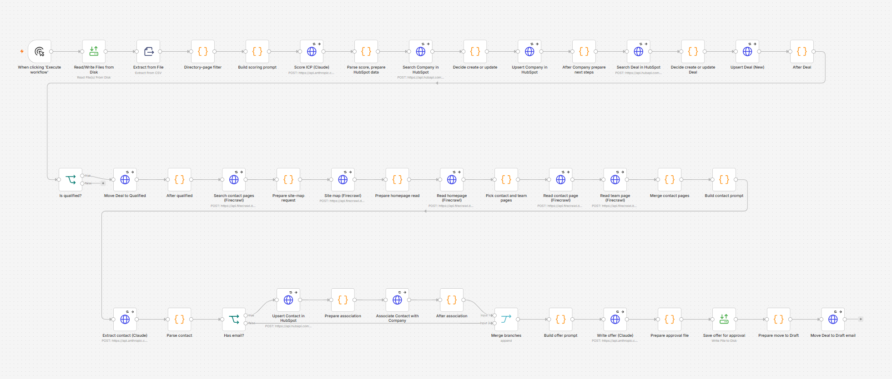
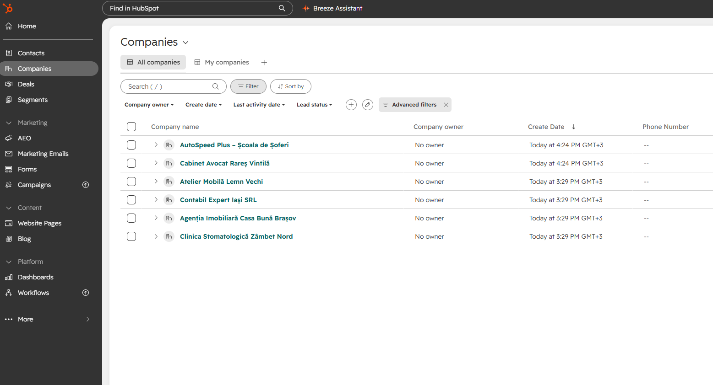
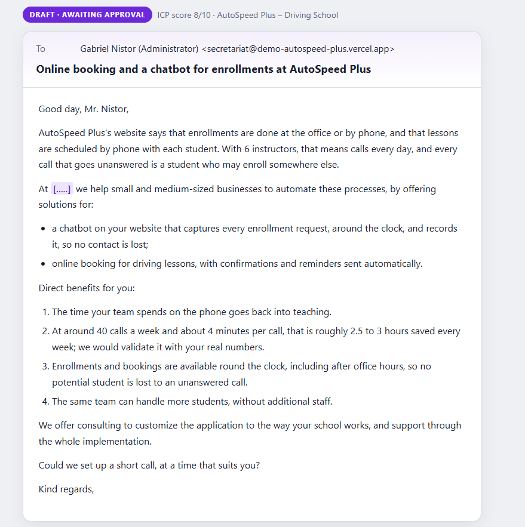

# B2B Sales Funnel (MVP)

**5 specialized AI agents orchestrated by n8n** - finds prospects, score leads, build the CRM in HubSpot and draft personalized offers, with human approval before sending. From a list of companies to a **personalized, ready-to-approve offer**, with the CRM updated along the way. Built with **n8n** (orchestration), **Claude** (judgment and writing), **Firecrawl** (reading websites) and **HubSpot** (CRM).

> **Status:** working end to end, from company list to a reviewed offer. It was built and tested on real companies; this public demo runs on **fictional companies and mock websites** (`companii-demo.csv`, `demo-sites/`) because real company data cannot be published. **By design nothing is sent automatically**: every offer waits for a human to approve it.

**Project goal:** go through company data found on the internet, identify the best potential customers (AI lead scoring against an ideal customer profile, ICP), build the CRM in HubSpot (companies, contacts, deals) and prepare personalized offers.

## The agent team

| # | Agent | Role | Model |
|---|-------|------|-------|
| 1 | [prospector](agents/prospector-agent.md) | reads the company list, drops rankings and non-companies | rules, no AI |
| 2 | [icp-qualifier](agents/icp-qualifier-agent.md) | scores each company 1-10 against the ideal customer profile | Claude Haiku |
| 3 | [hubspot-sync](agents/hubspot-sync-agent.md) | creates the Company and the Deal in HubSpot, no duplicates | HubSpot API |
| 4 | [contact-finder](agents/contact-finder-agent.md) | finds the decision maker on the company's site | Firecrawl + Claude Haiku |
| 5 | [offer-writer](agents/offer-writer-agent.md) | drafts the email and the personalized offer, for human approval | Claude Sonnet |

Each agent has one job, clear inputs and outputs, and its real prompt documented in [`agents/`](agents/README.md). They run as nodes inside n8n, not as separate files: n8n is the conductor (order, branching, HubSpot, files), and Claude is called only where judgment or text is needed.

**Live flow diagram** of all 42 nodes, with explanations: **[adelinalsidor.github.io/sales-funnel-b2b-n8n](https://adelinalsidor.github.io/sales-funnel-b2b-n8n/)** (source: [`docs/schema-flux.html`](docs/schema-flux.html)).

> **A note on language:** the target market is Romanian SMEs, so the agent prompts, the demo data and the generated offers are in **Romanian**. The documentation and the n8n node names are in English.

## Screenshots

**The flow in n8n** (42 nodes, grouped in sections, left to right):



**HubSpot**: the demo companies created by the flow, with no duplicates:



**An offer draft**, written from the company's own website and waiting for approval:



## Flow diagram

```
CSV with companies
   │
   ▼
Directory-page filter ──► drops listicles ("Top 10 firms...")
   │
   ▼
Claude Haiku ──► ICP score 1-10 + label (qualified ≥ 6) + reason
   │
   ▼
HubSpot: look up the company by domain ──► exists? PATCH : POST   (no duplicates)
   │
   ▼
HubSpot: Deal in the "Funnel B2B" pipeline, stage NEW (looked up by name, no duplicates)
   │
   ▼
Qualified?
   ├─ no ──► done (the Deal stays in "New", the score is stored on the company)
   └─ yes ─► Deal → stage QUALIFIED
       ▼
   Firecrawl: search + site map + homepage links → contact and team pages
       ▼
   Claude Haiku: extracts the decision maker (never invents; otherwise "not found")
       ▼
   Has email? ── yes ──► HubSpot: upsert Contact (by email) + associate with Company
       │ no ────────────────────────────┐
       ▼                                ▼
                 Merge
                    ▼
   Claude Sonnet: email + pain points + offer (no invented prices or figures)
                    ▼
   oferte-de-aprobat/<company>.md   (status: pending / approved / rejected)
                    ▼
   Deal → stage DRAFT EMAIL
                    ▼
   (next step) review + send ──► Deal → stage REVIEW AND SEND
```

**HubSpot pipeline "Funnel B2B":** New → Qualified → Draft email → Review and send. The last stage is prepared but nothing moves into it automatically yet; it will be wired to real email sending.

The exported flow is in [`workflow/sales-funnel.json`](workflow/sales-funnel.json) (no keys; credentials stay in n8n).

## Design decisions

- **Idempotent:** run it as many times as you like, it creates no duplicates. Companies are looked up by domain, deals by name, contacts by email.
- **Never invents:** if the site has no name or detail, the result says "not found" / "insufficient details".
- **One job per agent:** five small agents with clear inputs and outputs are easier to test, fix and replace than one big prompt.
- **Right model for the job:** Haiku (cheap) for scoring and extraction, Sonnet for writing the offer. `temperature: 0` for scoring, so results are repeatable.
- **Human in the loop:** an offer goes out only after `status` in its file is manually set to `approved`.
- **Works on sites search engines don't know:** contact discovery combines a search with a site map and the homepage links, then reads the contact and team pages directly (cache bypassed).
- **Tolerates dirty data:** external calls retry, and an error on one company does not stop the rest of the batch.

## Results

**Development runs on real companies** (names withheld): 8 companies in, 6 qualified, 6 personalized offers drafted from each company's own website, 8 Deals in HubSpot with no duplicates over repeated runs.

**Public demo (8 rows, fictional companies):**

| Step | Result |
|---|---|
| Directory-page filter | 1 ranking page ("Top 10 clinics...") removed, 7 companies remain |
| ICP scoring | 6 qualified; the large company, already running a chatbot, came out unqualified (2/10) |
| HubSpot | 6 companies and 6 Deals in "Draft email", **no duplicates** after repeated runs |
| Contact | 4 with email, 1 found without email, 1 "not found" (nothing invented) |
| Offers | 6 drafts with concrete details taken from each company's site, in `oferte-de-aprobat/` |

## Demo with fictional companies

Firecrawl runs in the cloud, so it cannot read sites from `localhost`. That is why [`demo-sites/`](demo-sites/) contains 6 small invented websites (home, team, contact) published on Vercel as `demo-<name>.vercel.app`. The company list is in `companii-demo.csv`. All names, people and emails in the demo are fictional; the demo emails use each site's own domain so HubSpot associates every contact with the right company.

## How to run

1. Create a `.env` with `HUBSPOT_TOKEN`, `FIRECRAWL_API_KEY`, `ANTHROPIC_API_KEY` (and `N8N_API_KEY` only if you edit the flow through the n8n API). It is git-ignored.
2. Start n8n with access to the project folder:
   ```powershell
   $env:NODE_OPTIONS = "--dns-result-order=ipv4first"
   $env:N8N_RESTRICT_FILE_ACCESS_TO = "C:\Users\<you>\.n8n-files;<path to this folder>"
   n8n start
   ```
3. Import `workflow/sales-funnel.json` and connect the credentials (Anthropic, HubSpot, Firecrawl). Put the company list you want in `.n8n-files` (for the demo: `companii-demo.csv`, with the fictional sites from `demo-sites/` deployed), set its name in the `Read/Write Files from Disk` node and click **Execute workflow**.
4. Open the files in `oferte-de-aprobat/` (created on the first run, git-ignored), read them and set `status`.

## Known limitations
The 8-company batch is a validation set, not a volume test: compact enough to keep run time (~5 minutes) and API cost low, yet varied enough to exercise every branch of the flow: qualified and unqualified companies, contacts found with and without email, and contacts not found. Scale is limited only by the Firecrawl plan's request rate.
  
- A new run **overwrites** the files in `oferte-de-aprobat/` and resets `status`. Move approved offers elsewhere.
- Contact discovery depends on what is public on the site; LinkedIn is not covered (anti-scraping protection).
- Firecrawl rate-limits requests per minute (error `429`). The nodes that read sites send one request every 7 seconds, so a run on 8 companies takes about 5 minutes.
- The company list is prepared outside the flow (the MVP has no automatic internet search step in n8n).
- Errors returned by HubSpot do not stop the flow, so they can go unnoticed (see the roadmap).
- The price in the offer is a placeholder (`[PREȚ DE COMPLETAT]`), filled in by hand.

## Roadmap

- Real email sending, with approval (moves the Deal to "Review and send")
- `lead-responder-agent` (reply to incoming leads)
- Contact finder for LinkedIn
- PDF offer generated from a template
- Surface HubSpot errors instead of continuing silently

## License

[MIT](LICENSE) © 2026 Adelina Sidor. The companies, people and emails in the demo are fictional.
